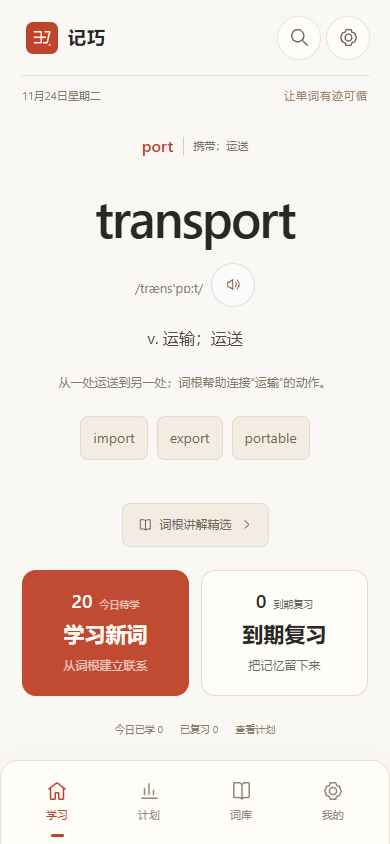
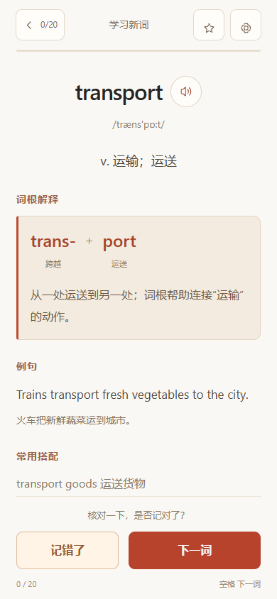

# 记巧

用词根串起单词。暖白与朱橙界面，常规单词卡学习，支持电脑与手机网页，以及 Android 离线安装包。

**[打开网页版](https://mind-tunnel-code.github.io/jiqiao/)** · **[下载 Android APK](https://github.com/Mind-Tunnel-code/jiqiao/releases/latest)**

## 怎么学

选择词书 → 学习新词 / 到期复习 → 我认识 / 不认识 → 核对释义与词根解释 → 下一词。记错直接点“记错了”。

在选定词书中，首轮按同词根的待学成员连续出词；错词稍后再练。复习根据实际回忆表现和间隔安排，不强制按词根扎堆。没有可靠词根关联的词不硬拆，按词书顺序补充。

## 每日学习量

v1.0.1 起可自行填写大于 0 的整数，不设固定数量上限；到期复习单独计算。实际新词不超过所选词书剩余未学词。较大的任务可暂停、刷新或通过备份恢复。

## 离线与进度

- 分享版免登录，进度、收藏和笔记保存在当前设备；通过“我的 → 导出备份 / 恢复备份”迁移。
- APK 自带词库和全部内置发音，断网可用。Android 8.0 或以上，需要较新的系统 WebView。
- 网页首次加载需要网络，页面及词库缓存后可离线学习；发音在播放后逐个缓存。
- 旧网页记录可以导出后恢复到 APK。网页与 APK 不自动同步。
- 卸载应用、清除应用或浏览器数据前，请先导出备份。

## 内容范围

7,162 个词条，366 组构词家族，1,864 个词附明确关联，其中 387 个附完整讲解。并非全词库都有完整词根讲解。四级 / 六级参考、通用词频、进阶精选等词表按公开词典标签整理，不标作最新真题考频或官方核定词表。

内置发音为预先合成的 LJ Speech 美式女声，尚未全部人工校听。内容与许可说明见应用“我的 → 内容来源与审核范围”。

## 界面

 

## 发布说明

此仓库用于发布网页版成品、说明及安装包下载。Android 开发工程、私有站点配置、用户学习记录和签名私钥均未上传。第三方材料保留各自许可；本项目没有为作者原创内容额外授予开源许可。

已完成逻辑、浏览器及离线场景检查；APK 正式构建、静态检查和签名校验通过。初版尚未完成安卓真机安装测试。

[隐私说明](PRIVACY.md) · [第三方来源](THIRD_PARTY_NOTICES.md)
